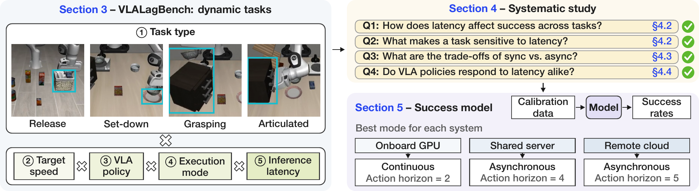

# VLALagBench

Code and data for *VLALagBench: Understanding When and Why VLA Inference
Latency Matters*. The Python package is `vlalagbench`.

Qi Wen¹, Borui Xu¹, Hussein Amro¹, Hongshi Tan¹, Hanmin Lin², Chaoyi Ruan¹,
Shanghao Liu¹, Gang Yang¹, Yuejiang Liu¹³, Jiafei Duan¹, Bingsheng He¹,
Jason Clemons⁴, Christos Kozyrakis³⁴, Wenqi Jiang¹

¹National University of Singapore, ²Nanyang Technological University,
³Stanford University, ⁴NVIDIA

📄 **Paper:** [VLALagBench: Understanding When and Why VLA Inference Latency Matters](https://arxiv.org/abs/2611.03103)

<p align="center">
  <a href="https://arxiv.org/abs/2611.03103">
    
  </a>
</p>

VLALagBench is a benchmark for how inference latency affects the task success of
vision-language-action (VLA) policies on moving targets. Four LIBERO tasks in
MuJoCo drive their target along a closed path while contact physics stays
native:

| Interaction | LIBERO task | Moving target |
| --- | --- | --- |
| Release | Object 1: cream cheese into the basket | basket |
| Set-down | Spatial 9: bowl onto the plate | plate |
| Grasping | Spatial 9: bowl onto the plate | cabinet carrying the bowl |
| Articulated | Goal 0: open the middle drawer | cabinet |

Each condition fixes a target speed, an execution mode (synchronous, lazy
asynchronous, or continuous asynchronous), and an injected inference latency.
Latency is simulated: a chunk becomes available a fixed number of control
steps after its request while physics keeps running, and steps spent waiting
do not count against the episode's action budget. Evaluated policies are
pi0.5 (openpi, and FlashRT serving), GR00T N1.7, and MolmoAct2, all from public
LIBERO checkpoints. A second simulator, Isaac Sim with DynamicVLA on its DOM
benchmark, repeats the release and grasping interactions
([DynamicVLA](docs/DYNAMICVLA.md)).

The repository contains the evaluator, every study specification behind the
paper's results, the published success tables, and the analysis that turns
them into the paper's figures and latency model.

## Layout

- `src/vlalagbench/`: evaluator, execution scheduler (`timing.py`), target
  motion (`trajectory.py`, `simulators/mujoco/dynamics.py`), policy servers,
  and the study runner.
- `configs/experiments/`: task definitions (one YAML per task and initial-state
  bank). `configs/studies/`: the sweeps behind each published result, one
  directory per study with a README. `configs/placements/`: where a study runs.
- `results/`: published success tables and figures ([index](results/README.md)).
- `analysis/`: the paper's figures, numbers, and latency model
  ([README](analysis/README.md)).
- `website/`: project page, figures, and demo videos; deployed to GitHub Pages
  by GitHub Actions ([website README](website/README.md)).
- `scripts/studies/`: rebuild a pooled result folder from its verified studies.
- `scripts/latency/`: batch-1 inference latency per GPU and stack.
- `third_party/`: pinned dependencies (openpi with LIBERO, Isaac-GR00T), read-only.

## Setup

Python 3.11 with [uv](https://docs.astral.sh/uv/); Git LFS. GR00T demo data is
not needed and can stay as LFS pointers.

```bash
git clone https://github.com/codestrongestx/vla-lag-bench.git
cd vla-lag-bench
GIT_LFS_SKIP_SMUDGE=1 git submodule update --init third_party/openpi/third_party/libero third_party/Isaac-GR00T
uv sync --locked
uv run pytest
```

`uv sync` installs the simulator side (LIBERO, MuJoCo, the study runner).
Each policy is served from its own environment; a placement names that
environment's interpreter as `policy_python`.

| Policy | Environment | Checkpoint |
| --- | --- | --- |
| pi0.5 (openpi JAX) | `uv sync --project third_party/openpi` (Python 3.11) | `gs://openpi-assets/checkpoints/pi05_libero`, fetched by openpi |
| pi0.5 (FlashRT bf16) | openpi's environment plus FlashRT 0.2.0, torch 2.7.1, flash-attn 2.8.3 | `$VLALAGBENCH_CHECKPOINTS/pi05_libero_pytorch`, converted with openpi's `examples/convert_jax_model_to_pytorch.py` |
| pi0.5 (openpi PyTorch) | openpi's environment with its transformers patch applied | the same converted checkpoint |
| GR00T N1.7 | `third_party/Isaac-GR00T` (Python 3.12), see below | `nvidia/GR00T-N1.7-LIBERO` at the revision pinned in each spec |
| MolmoAct2 | Python 3.12, torch 2.10 (CUDA 12.8), transformers 5.3.0 | `allenai/MolmoAct2-LIBERO` at the revision pinned in each spec |

GR00T needs Hugging Face access to `nvidia/Cosmos-Reason2-2B` unless its files
are cached:

```bash
GR00T_ENV="$HOME/.venvs/vlalagbench-gr00t"
UV_PROJECT_ENVIRONMENT="$GR00T_ENV" uv sync --project third_party/Isaac-GR00T --frozen --no-dev --no-install-project --python 3.12
uv pip install --python "$GR00T_ENV/bin/python" 'pydantic>=2.12,<3' 'pyyaml==6.0.2' 'websockets==15.0.1'
```

The PyTorch checkpoint conversion and both PyTorch servers need openpi's
transformers patch (`third_party/openpi/README.md`, PyTorch setup step 3) in the
environment that runs them. Install FlashRT from its git checkout so each run
records its commit.

Local checkpoints are written `$VLALAGBENCH_CHECKPOINTS/<name>` in the specs;
set `VLALAGBENCH_CHECKPOINTS` to the directory holding them. On H100s, FlashRT
builds no FA2 module, so set `FVK_RTX_FA2=0` to route attention through
flash-attn.

## Run a study

A study expands one experiment into a sweep; a placement says which GPUs, CPU
cores, workers, and policy interpreter run it. Placements never change a
trajectory and do not enter the study hash. The study's `policy` section sets
how the server batches requests; the placement sets workers and rendering.
Edit `configs/placements/libero.yaml` (4 workers) or `libero_batched.yaml`
(48 workers and policy-frame rendering, the layout of the paper's batched
runs) for your host.

```bash
uv run vlalagbench study plan configs/studies/libero_latency_grid_20261014/plate_lazy.yaml \
  --placement configs/placements/libero_batched.yaml
uv run vlalagbench study run configs/studies/libero_latency_grid_20261014/plate_lazy.yaml \
  --placement configs/placements/libero_batched.yaml \
  --select trajectory.speed_mps=0.1 --select inference.latency_ms=150
```

`--select` runs a subset of points; omit it to run the whole sweep. Each point
runs 200 episodes (50 official initial states, two path start phases, both
directions). Rerunning resumes: completed points are verified and kept, and
incomplete attempts move to `failed/`. A study refuses to resume if its
experiment, evaluator sources, or numerical environment changed.

```bash
uv run vlalagbench study status studies/pi05_plate_lazy_b32_20261014
uv run vlalagbench study verify studies/pi05_plate_lazy_b32_20261014
uv run vlalagbench study report studies/pi05_plate_lazy_b32_20261014
uv run vlalagbench study videos studies/pi05_plate_lazy_b32_20261014 --gpu 0 --workers 4
```

`report` writes the point table (`plot_data.csv`) and three-panel figure, and
with `--publish DIR` copies them with a study record. `videos` replays three
successes and three failures per point from saved states; traces store states
only. Policy noise is seeded per request, so batched and single-request
serving give each episode the same noise.

To evaluate one experiment without a study, start a policy server and run the
evaluator in a second terminal:

```bash
PYTHONPATH=src uv run --project third_party/openpi python \
  src/vlalagbench/benchmarks/libero/policy_server.py \
  --experiment configs/experiments/libero/pi05_libero_spatial.yaml --runtime configs/runtime/libero.yaml
uv run vlalagbench eval configs/experiments/libero/pi05_libero_spatial.yaml configs/runtime/libero.yaml
```

## Reproduce the paper

- Success tables: `configs/studies/<study>/` holds the specs for each folder
  in `results/`; the results index maps them to the paper's tasks and
  policies. Every published row records its run ID and evaluating commit.
- Figures and numbers: `python -m analysis.reproduce` rebuilds the paper's 24
  figures from `results/` and the derived tables in `analysis/data/`, and
  prints the latency model's fits, blind test, and calibration
  ([analysis](analysis/README.md)).
- Latency table: `scripts/latency/policy_latency.py` measures batch-1 pi0.5
  latency on one GPU from recorded or synthetic requests; the paper's openpi
  column is openpi's PyTorch bf16 model and its FlashRT column FlashRT bf16,
  both at the 99th percentile. The end-to-end columns add the cited network
  delays (5 ms WiFi 7, 25 ms 5G). `latency_table.py` tabulates records.

Raw artifacts (recorded videos, simulation state traces, and per-run
configurations) will be released separately. The published success tables and
derived analysis tables are included here. Reproducing the recorded scene
figures and tolerance-zone views also requires those raw artifacts and, for
some views, re-running the measurements; the reproduction command skips the
raw-dependent renderers when the artifacts are absent. See the
[analysis README](analysis/README.md) for the required inputs.

## License

Unless otherwise noted, original code, data, and documentation in this
repository are licensed under the [Creative Commons Attribution–NonCommercial
4.0 International license (CC BY-NC 4.0)](LICENSE). You may share and adapt
this material for noncommercial purposes with appropriate attribution, a link
to the license, and an indication of any changes.

Third-party components, including those under `third_party/`, and externally
obtained models and assets retain their respective licenses.
