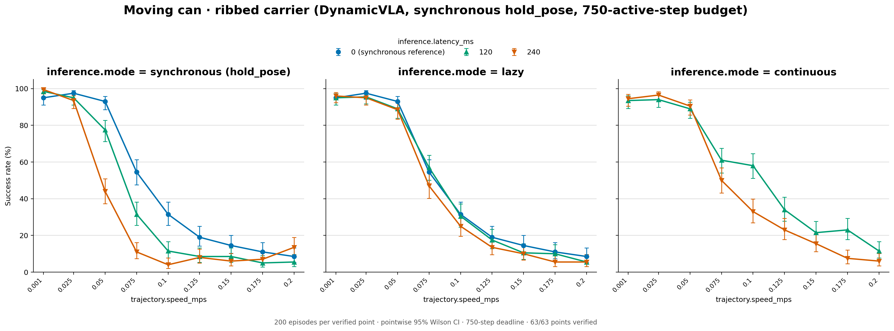

# DynamicVLA moving food can (ribbed carrier): pooled 200-condition results

[Figure](success_rates.png) · [Data](plot_data.csv) · [Source records](sources.json)

The 45 synchronous 0 ms, lazy and continuous settings are published here,
each with 200 conditions (9,000 episodes, 4,246 successes); the 18 synchronous
120 and 240 ms settings come from the reruns in `dynamicvla-sync-hold-pose/`
(last section), which also holds the full 63-setting grid. Every setting pools the 20 pilot conditions with
the 180 remaining conditions of the ribbed 200-episode bank; success counts are
added before calculating rates and pointwise 95% Wilson intervals. The layout
matches the food-can04 200-condition figure: synchronous, lazy, and continuous
panels with latency curves, and a linear speed axis with ticks at the nine
measured LIBERO speeds (0.001–0.2 m/s). The 0.001 m/s point is slow motion, not
a static baseline. The synchronous 0 ms curve is repeated in the lazy panel as
a shared reference, labeled in the legend; continuous has no 0 ms curve.

Success rates (%) by speed (m/s):

| Mode, latency | 0.001 | 0.025 | 0.05 | 0.075 | 0.1 | 0.125 | 0.15 | 0.175 | 0.2 |
|---|---|---|---|---|---|---|---|---|---|
| synchronous 0 ms | 95.0 | 97.5 | 93.0 | 54.5 | 31.5 | 19.0 | 14.5 | 11.0 | 8.5 |
| synchronous 120 ms (rerun) | 98.5 | 95.0 | 77.5 | 31.5 | 11.5 | 8.5 | 8.5 | 5.0 | 5.5 |
| synchronous 240 ms (rerun) | 99.5 | 93.5 | 44.0 | 11.0 | 4.0 | 8.0 | 6.0 | 7.0 | 13.5 |
| lazy 120 ms | 95.0 | 95.5 | 89.0 | 57.0 | 30.5 | 17.5 | 10.5 | 10.0 | 5.5 |
| lazy 240 ms | 96.0 | 95.0 | 88.5 | 47.0 | 25.0 | 13.5 | 10.0 | 5.5 | 5.5 |
| continuous 120 ms | 93.5 | 94.0 | 89.0 | 61.0 | 58.0 | 34.0 | 21.5 | 23.0 | 11.5 |
| continuous 240 ms | 94.5 | 96.5 | 90.5 | 50.0 | 33.0 | 23.0 | 15.5 | 7.5 | 6.0 |

Up to 0.025 m/s every setting succeeds in 93.5–99.5% of conditions. From
0.05 m/s, synchronous inference loses most to latency (44.0% at 240 ms vs 93%
at 0 ms). Lazy roughly recovers the 0 ms synchronous curve at both latencies. Continuous at 120 ms is the only setting clearly above the 0 ms synchronous
reference at 0.1–0.175 m/s (58% vs 31.5% at 0.1 m/s). These are descriptive
comparisons, not paired tests.

Both components ran on RTX 3090 GPUs 4-7 (two simulators per GPU
sharing one inference backend, CPUs 0-27). The remaining 180 ran October 9-10,
2026 at commit 7c0468d0 (synchronous) and ba67a673 (lazy, continuous; the commits in
between add only a placement file and the pilot results), finishing at 20:43 China time on October
10. The pilot component is the RTX 3090 server rerun of the pilot (same study hashes
as the RTX 4090 pilot, `configs/studies/fcan04_moving_can_pilot20_20261008/`), run at
ba67a673 immediately after and finished at 00:23 China time on October 11; it
scored 555/1,260 against 547/1,260 on the 4090s. The first 10 episodes of every
point were recorded live on video.

The combining script
checks study hashes, episode-summary SHA-256 checksums, episode identities,
counts, successes, model/inference agreement, and the disjoint 20+180 source
condition selection. Run IDs, code revisions, source hashes, and per-component
counts are retained in sources.json.

Reproduce the figure from the repository root:

```sh
.venv/bin/python \
  scripts/studies/plot_fcan04_moving_can200_20261008.py \
  studies/fcan04_moving_can_pilot20_20261008 \
  studies/fcan04_moving_can_remaining180_20261008 \
  results/dynamicvla/fcan04_moving_can200_20261008
```

## Synchronous reruns with the arm holding still

`dynamicvla-sync-hold-pose/`: the full 63-setting grid the paper reports, with
every synchronous 120 and 240 ms point from reruns that hold the arm still
during waits (specs: `configs/studies/dynamicvla_sync_hold_pose_20261027/`).
The first synchronous runs re-sent the last absolute pose target on every
inference-wait tick, so the arm kept moving toward it while it waited; they
are not published. The reruns read the hand pose on the first wait tick after
a model action and hold it, with the last gripper command, until the next
action arrives. They cover all nine speeds at 120 and 240 ms, 200 conditions
per point (the same 20 + 180 split, pooled the same way), 750 active steps,
same checkpoint, chunk 20 and execution horizon 14. RTX 3090s, October 27–28,
2026, commits `9f6cab25` (240 ms pilot), `e5f168f3` (240 ms, 0.025–0.1 m/s,
remaining 180) and `aaed6c13` (the rest); all points verified. The synchronous
0 ms, lazy and continuous points are those above. `plot_data.csv` gives each
row's `idle_control` and `source`; `sources.yaml` lists both components of
each rerun point.

Hand motion during a wait, measured from the traces (end-effector distance
from where the wait began to where the next action is applied, median / p90):

| Latency | Last target re-sent (first runs) | Held |
|---|---|---|
| 120 ms (3 wait steps) | 17–25 / 64–78 mm | 3.8–4.8 / 14–18 mm |
| 240 ms (6 wait steps) | 26–33 / 100–108 mm | 2.0–3.0 / 9–14 mm |

What remains is the arm coasting on its entry speed, about 5 mm peak at the
median.


