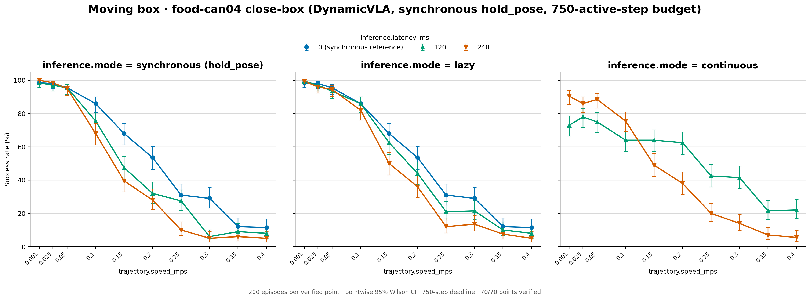

# DynamicVLA food-can04: pooled 200-condition results

[Figure](success_rates.png) · [Data](plot_data.csv) · [Source records](sources.json)

The 50 synchronous 0 ms, lazy and continuous settings are published here,
each with 200 conditions (10,000 episodes); the 20 synchronous 120 and 240 ms
settings come from the reruns in `dynamicvla-sync-hold-pose/` (last section),
which also holds the full 70-setting grid. The original 49 settings pool 20 pilot + 180 remainder conditions. The 21 speed-extension settings at 0.15, 0.25, and 0.35 m/s ran once on the
same 200 conditions (different episode order) on October 2-3, 2026, with the
same checkpoint, inference settings, and 750-step deadline. Success counts are added before calculating rates
and pointwise 95% Wilson intervals. The existing LIBERO three-panel renderer
provides synchronous, lazy, and continuous panels with latency curves and a
linear speed axis with ticks at the seven measured speeds, starting explicitly
at 0.001 m/s. The 0.001 m/s condition is slow motion, not static. The synchronous 0 ms curve and its confidence intervals are repeated only in the
lazy panel as a shared reference, labeled in the legend. Continuous has no 0 ms
curve. These are
the same synchronous measurements; CSV rows and trial counts are not duplicated.

Continuous at 0.2 m/s and 240 ms includes the completed October 1 retry:
70/180 remainder successes plus 6/20 pilot successes, giving 76/200 (38%). The retry was verified at 12:37:34 China time. The earlier failed attempt's
partial episodes are excluded. All curves now have complete setting coverage.

At 120 ms and 0.2 m/s, success rates are 32% synchronous (rerun), 44% lazy,
and 62.5% continuous. At 0.3 m/s they are 6%, 21.5%, and 41.5%. Continuous has
lower success at slow speeds: at 0.001 m/s and 120 ms it reaches 73%, compared
with 98.5% synchronous and 99.5% lazy. These are descriptive comparisons, not paired tests.

In the extension, continuous at 120 ms keeps its fast-speed lead: 42.5% at
0.25 m/s versus 27.5% synchronous and 21% lazy, and 21.5% at 0.35 m/s versus
9% and 10%. At 240 ms continuous matches lazy (20% vs 12% at 0.25 m/s, 7% vs
7.5% at 0.35 m/s).

The combining script
checks study hashes, episode-summary SHA-256 checksums, episode identities,
counts, successes, model/inference agreement, and the disjoint 20+180 source
condition selection. Full trace files were not downloaded or reverified for
this report; it uses the source's verified point records. Run IDs, code revisions,
source hashes, and per-component counts are retained in sources.json.

The CLI `vlalagbench study report DIRECTORY` reports a single study. Like the
existing LIBERO and DynamicVLA pilot combining scripts, this script reuses
`vlalagbench.study.report.plot` and `write_plot_data` for the combined figure:

```sh
.venv/bin/python \
  scripts/studies/plot_fcan04_native200_20261001.py \
  studies/fcan04_native_pilot20_20260928 \
  studies/fcan04_plot_snapshot_20261001 \
  results/dynamicvla/fcan04_native200_20261001 \
  --extension studies/fcan04_native200_speed_extension_20261001
```

## Synchronous reruns with the arm holding still

`dynamicvla-sync-hold-pose/`: the full 70-setting grid the paper reports, with
every synchronous 120 and 240 ms point from reruns that hold the arm still
during waits (spec: `configs/studies/dynamicvla_sync_hold_pose_20261027/box.yaml`).
As for the moving can, the first synchronous runs re-sent the last absolute
pose target on every inference-wait tick, so the arm kept moving toward it
while it waited; they are not published. The reruns cover all ten speeds at
120 and 240 ms on the same 200 conditions (the speed-extension base, which
covers the original 20 + 180 conditions in a different episode order), 750
active steps, same checkpoint, chunk 20 and execution horizon 14.

One study (hash `c42c93b18d59…`), run on RTX 3090s on October 29–30, 2026 at
commits `beddc3d7` (0.4 and 0.35 m/s) and `86d7d55f` (the rest; it only adds a
placement, so the evaluator code is the same), in two directories with the
same study hash (`…-gpu5` for 0.3, 0.05, 0.025 and 0.001 m/s). Each point is
recorded in exactly one of them, and all 20 points are verified. The
synchronous 0 ms, lazy and continuous points are those above. `plot_data.csv`
gives each row's `idle_control` and `source`; `sources.yaml` lists each rerun
point's record.

Hand motion during a wait, measured from the traces (end-effector distance
from where the wait began to where the next action is applied, median / p90):

| Speeds | Latency | Last target re-sent (first runs) | Held |
|---|---|---|---|
| 0.001–0.05 m/s | 120 ms | 21 / 62 mm | 4.3–4.6 / 17–19 mm |
| 0.001–0.05 m/s | 240 ms | 28–33 / 92–98 mm | 2.2–2.6 / 11–13 mm |
| 0.1–0.4 m/s | 120 ms | 0.6–9 / 39–50 mm | 0.1–1.9 / 9–12 mm |
| 0.1–0.4 m/s | 240 ms | 0.8–10 / 59–75 mm | 0.1–0.9 / 8–9 mm |

Success rates (%) by speed (m/s):

| Setting | 0.001 | 0.025 | 0.05 | 0.1 | 0.15 | 0.2 | 0.25 | 0.3 | 0.35 | 0.4 | Total |
|---|---|---|---|---|---|---|---|---|---|---|---|
| synchronous 120 ms | 98.5 | 97.0 | 95.5 | 75.5 | 47.5 | 32.0 | 27.5 | 6.0 | 9.0 | 8.0 | 993/2,000 (49.6%) |
| synchronous 240 ms | 100.0 | 98.5 | 95.0 | 68.0 | 39.5 | 28.0 | 10.0 | 5.0 | 6.0 | 5.0 | 910/2,000 (45.5%) |


