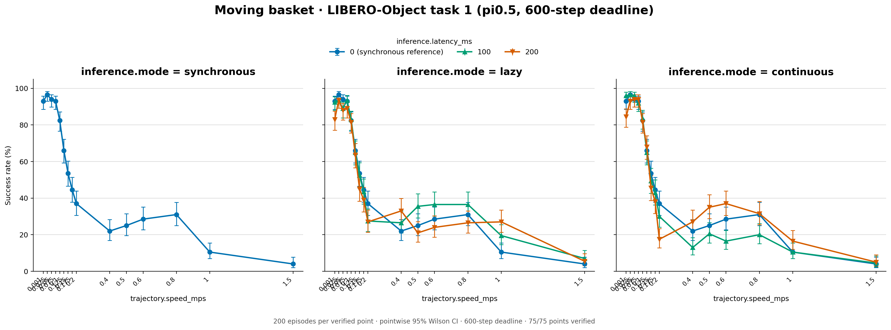
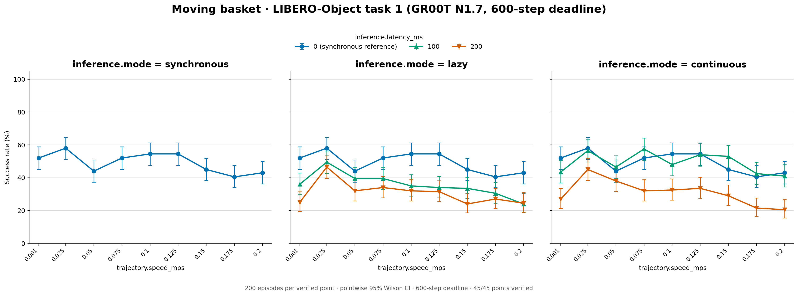
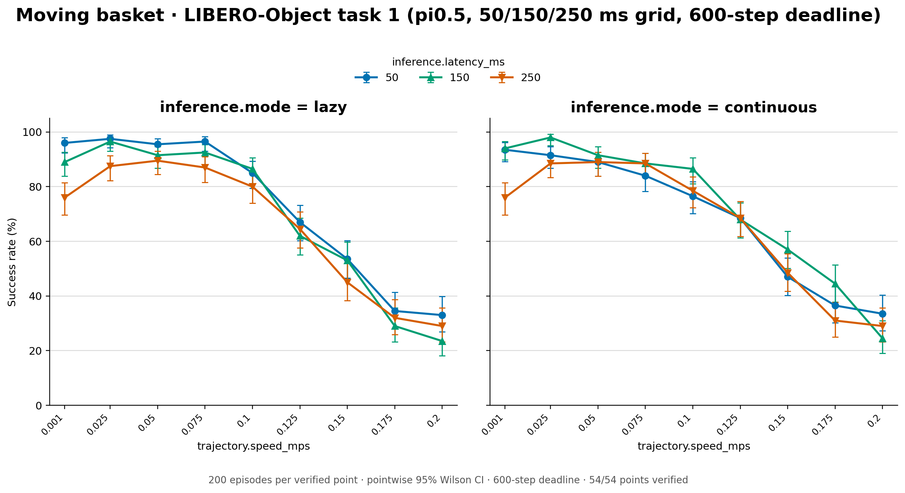
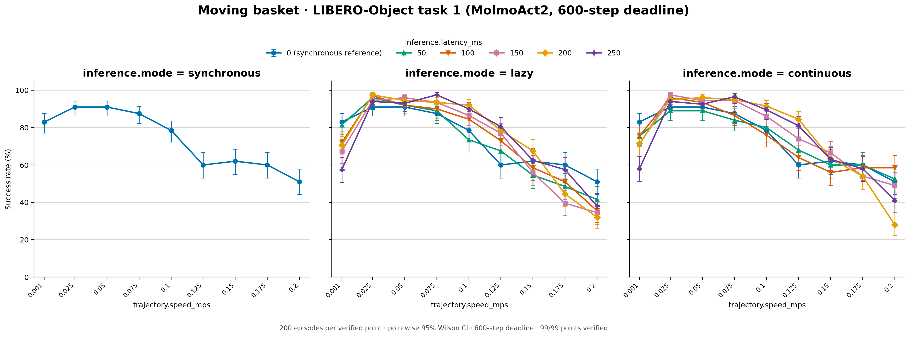
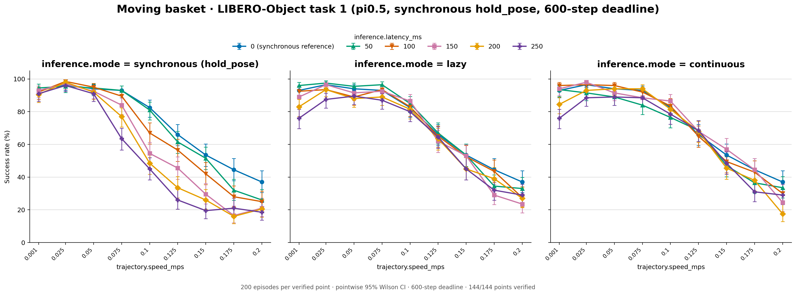
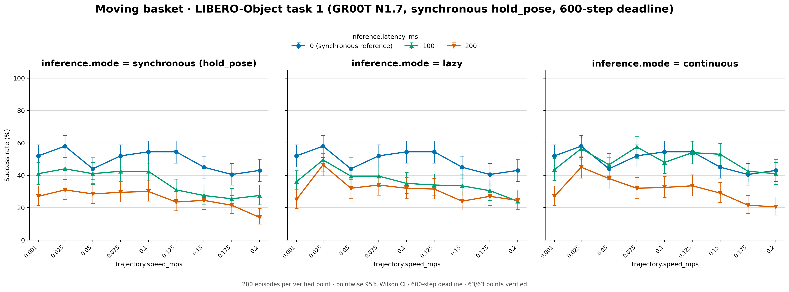
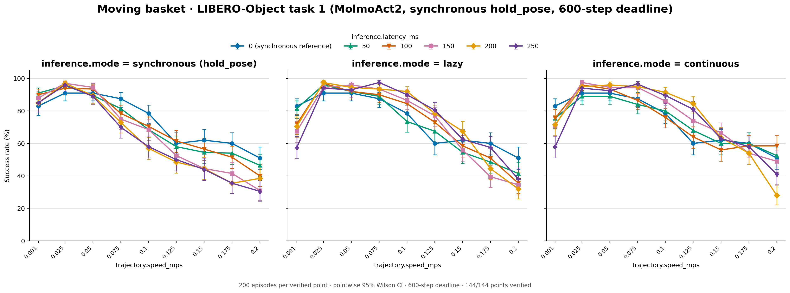

# Moving basket

LIBERO-Object Task 1 (put the cream cheese in the basket) with the basket
moving on its native ellipse.

Synchronous points with a nonzero delay are published only in the
`*-sync-hold-pose` folders (last section): their first runs let the arm keep
moving during inference waits, and the reruns hold it still, as synchronous
execution is defined. The other folders keep every other point as evaluated,
and the counts below leave out the synchronous points they no longer hold.

| Folder | Policy and serving | Run |
| --- | --- | --- |
| `pi05/` | pi0.5, one request per pass | RTX 3090 server, September 8 rerun plus September 11–12 speed extensions (`5fb893b5`); specs in `configs/studies/pi05_basket_20260908/` |
| `gr00t/` | GR00T N1.7 (`libero_object`), one request per pass | RTX 3090 server, September 15–17, 2026 (`e1384d8b`); details in `../gr00t_speed_sweep_20260914/README.md` |

Each folder holds the three-panel figure `success_rates.png` and
`plot_data.csv`; `gr00t/provenance.yaml` lists every run. Shared protocol:
200 episodes per point over the 50 official states with four phase/direction
conditions, 20 Hz, 10 warm-up steps, execution horizon 5, 600 acting steps;
synchronous and lazy at 0/100/200 ms, continuous at 100/200 ms. pi0.5 uses
chunks of 10, GR00T chunks of 16. Both cover 0.001 and 0.025–0.2 m/s; pi0.5
adds 0.4, 0.5, 0.6, 0.8, 1.0, and 1.5 m/s (90 published points against GR00T's 54).

| Folder | Synchronous 0 ms | Lazy | Continuous | Total |
| --- | --- | --- | --- | --- |
| `pi05` (90 points) | 1,562/3,000 | 4,700/9,000 | 3,009/6,000 | 9,271/18,000 (51.5%) |
| `gr00t` (54 points) | 887/1,800 | 2,083/5,400 | 1,443/3,600 | 4,413/10,800 (40.9%) |

Synchronous 0 ms by speed (0.001, 0.025, …, 0.2 m/s):

| Folder | Successes of 200 |
| --- | --- |
| `pi05` | 186 193 188 186 165 132 107 89 74 |
| `gr00t` | 104 116 88 104 109 109 90 81 86 |

## pi0.5 latency grid

`pi05-latency-grid/`: pi0.5 at the delays between the 0/100/200 ms points,
figure `success_rates.png` and `plot_data.csv`. Synchronous, lazy, and
continuous at 50/150/250 ms; 0.001 and 0.025–0.2 m/s by 0.025; same protocol as above (200 episodes
per point over the 50 official states, seeds 7, 20 Hz, 10 warm-up steps,
chunks of 10, execution horizon 5, 600 acting steps). One batched pi0.5
server per GPU (up to 32 requests) on H100 GPUs 6 and 7, October 14–15,
2026 (branch `libero-latency-grid`, merged in #5). Specs:
`configs/studies/libero_latency_grid_20261014/`. All 81 points verified; the
54 lazy and continuous points are published here.

| Folder | Lazy of 5,400 | Continuous of 5,400 | Total of 10,800 |
| --- | --- | --- | --- |
| `pi05-latency-grid` | 3,745 | 3,740 | 7,485 (69.3%) |

## MolmoAct2

`molmoact2/`: MolmoAct2 (`allenai/MolmoAct2-LIBERO`, revision `0d24a925`,
bf16, chunks of 10, execution horizon 5), figure `success_rates.png` and
`plot_data.csv`. 200 episodes per point over the 50 official states, seeds 7,
20 Hz, 10 warm-up steps, 600 acting steps; nine speeds (0.001, 0.025, 0.05, 0.075, 0.1, 0.125, 0.15, 0.175, 0.2 m/s);
synchronous, lazy, and continuous at 50/100/150/200/250 ms plus synchronous
at 0 ms. Serving batches up to 32 requests (padded to 8/16/24/32 rows) on
three H100 GPUs with all rendering on a fourth, October 15–17, 2026
(commit `c880056e`, branch `molmoact2`). Specs:
`configs/studies/molmoact2_libero_20261015/`. All 144 points verified; 99 are
published here.

| Folder | Synchronous 0 ms of 1,800 | Lazy of 9,000 | Continuous of 9,000 | Total of 19,800 |
| --- | --- | --- | --- | --- |
| `molmoact2` | 1,328 | 6,567 | 6,724 | 14,619 (73.8%) |

Synchronous 0 ms by speed: 166 182 182 175 157 120 124 120 102 (successes of 200).

## Paper grids: synchronous reruns with the arm holding still

`pi05-sync-hold-pose/`, `gr00t-sync-hold-pose/`, `molmoact2-sync-hold-pose/`:
each model's full grid on 0.001 and 0.025–0.2 m/s, the one the paper reports.
Every synchronous point with a nonzero delay comes from the
`sync_hold_pose_20261026` reruns (`configs/studies/sync_hold_pose_20261026/`),
which hold the pose where each wait began. The first runs of those points
stepped every wait tick with a zero action, and under robosuite's delta OSC a
zero action keeps the previous orientation goal, so the arm kept turning while
it waited. The reruns use the same checkpoints, chunks, execution horizon and
200 episodes per point as the runs they replace; H100s, October 26–27, 2026,
commit `cf31e659`, batched serving (up to 32 requests per pass), all points
verified.

The synchronous 0 ms points never wait (a 0 ms request is available on the
step it is sent) and come from the original runs, as do the lazy and
continuous points; lazy 0 ms runs are left out because they schedule like
synchronous 0 ms. `plot_data.csv` gives each row's `idle_control` (`hold_pose`
for the reruns) and its `source` folder or study. The first synchronous runs in `gr00t` and `pi05` served one request per pass, the reruns batched. pi0.5's speeds above 0.2 m/s have no rerun and no published synchronous points at nonzero delay.

| Folder | Lazy, continuous and 0 ms from | Rerun delays (ms) | Synchronous, held | Total |
| --- | --- | --- | --- | --- |
| `pi05-sync-hold-pose` | `pi05` + `pi05-latency-grid` | 50/100/150/200/250 | 5,460 of 9,000 (60.7%) | 19,299 of 28,800 (67.0%) |
| `gr00t-sync-hold-pose` | `gr00t` | 100/200 | 1,104 of 3,600 (30.7%) | 4,630 of 12,600 (36.7%) |
| `molmoact2-sync-hold-pose` | `molmoact2` | 50/100/150/200/250 | 5,988 of 9,000 (66.5%) | 20,607 of 28,800 (71.6%) |

Redraw a figure from its table with
`scripts/studies/plot_results_table.py FOLDER --title TITLE --deadline 600`.

## Execution-horizon validation

`pi05-horizon-validation/` holds pi0.5's asynchronous (lazy) runs at 50 ms with
execution horizons H = 2, 3 and 4 at the nine grid speeds, 200 episodes each
(H100 server, October 25, 2026, benchmark `829ae7c8`; spec
`configs/studies/horizon_validation_20261025/pi05_basket_lazy50.yaml`). The
paper uses them to test the speed-scaling model at horizons other than H = 5,
and H = 4 is System C's rate-capped continuous execution (Section 5).

| H | Success |
| --- | --- |
| 2 | 1,307/1,800 (72.6%) |
| 3 | 1,315/1,800 (73.1%) |
| 4 | 1,315/1,800 (73.1%) |
