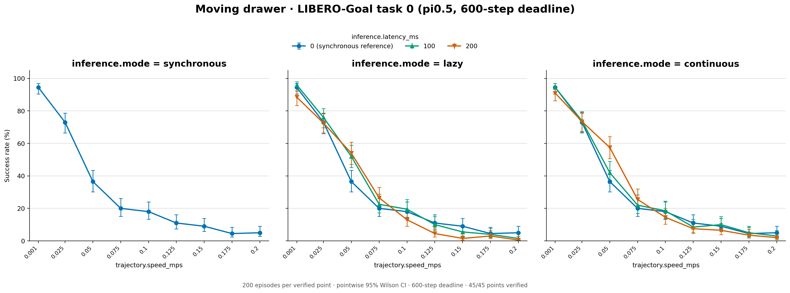
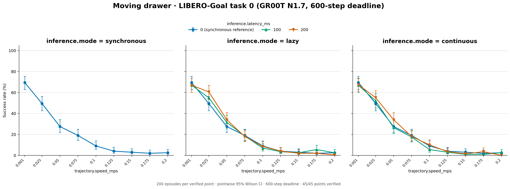
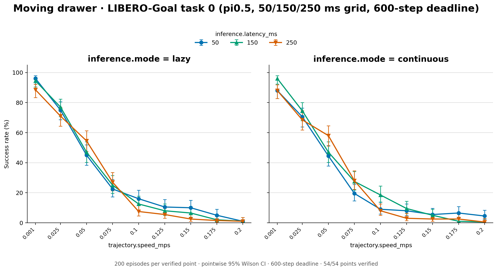
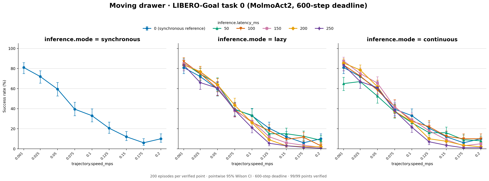
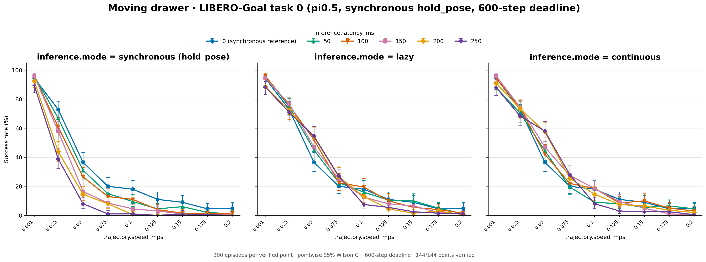
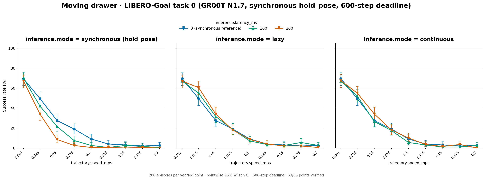
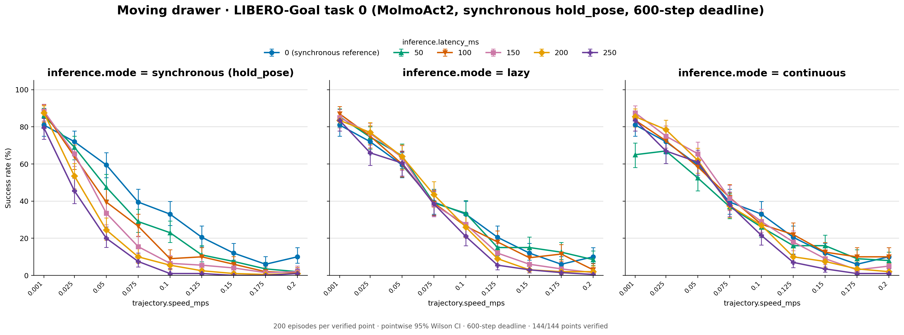

# Moving drawer, corrected layout

LIBERO-Goal Task 0 (open the middle drawer) with the cabinet moving on its
ellipse, on the corrected world placement from commit `d1e43e4b`: the
cabinet ellipse sits at (0.044606, -0.25403, 0.905) m in all 50 states.

Synchronous points with a nonzero delay are published only in the
`*-sync-hold-pose` folders (last section): their first runs let the arm keep
moving during inference waits, and the reruns hold it still, as synchronous
execution is defined. The other folders keep every other point as evaluated,
and the counts below leave out the synchronous points they no longer hold.

| Folder | Policy and serving | Run |
| --- | --- | --- |
| `pi05/` | pi0.5, one request per pass | RTX 3090 server, September 26–28, 2026 (`8d6550a`) |
| `gr00t/` | GR00T N1.7 (`libero_goal`), batches of up to 32 | H100 GPUs 0–1, October 4, 2026 (`a517b6fc`) |

Specs: `configs/studies/pi05_drawer_fixed_20260926/` and
`configs/studies/gr00t_drawer_fixed_20261004/`. Each folder holds the
three-panel figure `success_rates.png` and `plot_data.csv`. Both share the
protocol: 200 episodes per point over the 50 official states, seeds 7, 20 Hz,
10 warm-up steps, execution horizon 5, 600 acting steps; nine speeds (0.001,
0.025–0.2 m/s), synchronous and lazy at 0/100/200 ms, continuous at 100/200
ms. pi0.5 uses chunks of 10, GR00T chunks of 16. 72 points per folder, all
verified; 54 are published here.

| Folder | Synchronous 0 ms of 1,800 | Lazy of 5,400 | Continuous of 3,600 | Total of 10,800 |
| --- | --- | --- | --- | --- |
| `pi05` | 543 | 1,639 | 1,118 | 3,300 (30.6%) |
| `gr00t` | 372 | 1,144 | 738 | 2,254 (20.9%) |

Synchronous 0 ms by speed (0.001, 0.025, …, 0.2 m/s):

| Folder | Successes of 200 |
| --- | --- |
| `pi05` | 189 146 73 40 36 22 18 9 10 |
| `gr00t` | 139 99 55 38 18 8 6 4 5 |





Against the original placement, success over all 72 points as first
evaluated fell from 29.6% to 27.3% for pi0.5 and from 22.4% to 18.6% for
GR00T. A single-request
GR00T control showed batching does not explain the drop
(`configs/studies/gr00t_drawer_fixed_20261004/README.md`).

## Reproduce

```bash
PYTHONPATH=src .venv/bin/python scripts/studies/plot_pi05_drawer_fixed_20260926.py \
  PI05_STUDY_ROOT results/libero/20260926_moving-drawer-fixed/pi05
PYTHONPATH=src .venv/bin/python scripts/studies/plot_pi05_drawer_fixed_20260926.py \
  GR00T_STUDY_ROOT results/libero/20260926_moving-drawer-fixed/gr00t \
  --study-format 'gr00t_drawer_fixed_20261004_{mode}' \
  --modes synchronous lazy continuous --policy 'GR00T N1.7'
```

## pi0.5 latency grid

`pi05-latency-grid/`: pi0.5 at the delays between the 0/100/200 ms points,
figure `success_rates.png` and `plot_data.csv`. Synchronous, lazy, and
continuous at 50/150/250 ms; 0.001 and 0.025–0.2 m/s by 0.025; same protocol as above (200 episodes
per point over the 50 official states, seeds 7, 20 Hz, 10 warm-up steps,
chunks of 10, execution horizon 5, 600 acting steps). One batched pi0.5
server per GPU (up to 32 requests) on H100 GPUs 6 and 7, October 14–15,
2026 (branch `libero-latency-grid`, merged in #5). Specs:
`configs/studies/libero_latency_grid_20261014/`. All 81 points verified; the
54 lazy and continuous points are published here.

| Folder | Lazy of 5,400 | Continuous of 5,400 | Total of 10,800 |
| --- | --- | --- | --- |
| `pi05-latency-grid` | 1,627 | 1,589 | 3,216 (29.8%) |



## MolmoAct2

`molmoact2/`: MolmoAct2 (`allenai/MolmoAct2-LIBERO`, revision `0d24a925`,
bf16, chunks of 10, execution horizon 5), figure `success_rates.png` and
`plot_data.csv`. 200 episodes per point over the 50 official states, seeds 7,
20 Hz, 10 warm-up steps, 600 acting steps; nine speeds (0.001, 0.025, 0.05, 0.075, 0.1, 0.125, 0.15, 0.175, 0.2 m/s);
synchronous, lazy, and continuous at 50/100/150/200/250 ms plus synchronous
at 0 ms. Serving batches up to 32 requests (padded to 8/16/24/32 rows) on
three H100 GPUs with all rendering on a fourth, October 15–17, 2026
(commit `c880056e`, branch `molmoact2`). Specs:
`configs/studies/molmoact2_libero_20261015/`. All 144 points verified; 99 are
published here.

| Folder | Synchronous 0 ms of 1,800 | Lazy of 9,000 | Continuous of 9,000 | Total of 19,800 |
| --- | --- | --- | --- | --- |
| `molmoact2` | 667 | 3,162 | 3,131 | 6,960 (35.2%) |

Synchronous 0 ms by speed: 162 144 119 79 66 41 24 12 20 (successes of 200).



## Paper grids: synchronous reruns with the arm holding still

`pi05-sync-hold-pose/`, `gr00t-sync-hold-pose/`, `molmoact2-sync-hold-pose/`:
each model's full grid on 0.001 and 0.025–0.2 m/s, the one the paper reports.
Every synchronous point with a nonzero delay comes from the
`sync_hold_pose_20261026` reruns (`configs/studies/sync_hold_pose_20261026/`),
which hold the pose where each wait began. The first runs of those points
stepped every wait tick with a zero action, and under robosuite's delta OSC a
zero action keeps the previous orientation goal, so the arm kept turning while
it waited. The reruns use the same checkpoints, chunks, execution horizon and
200 episodes per point as the runs they replace; H100s, October 26–27, 2026,
commit `cf31e659`, batched serving (up to 32 requests per pass), all points
verified.

The synchronous 0 ms points never wait (a 0 ms request is available on the
step it is sent) and come from the original runs, as do the lazy and
continuous points; lazy 0 ms runs are left out because they schedule like
synchronous 0 ms. `plot_data.csv` gives each row's `idle_control` (`hold_pose`
for the reruns) and its `source` folder or study. The first synchronous runs in `pi05` served one request per pass, the reruns batched.

| Folder | Lazy, continuous and 0 ms from | Rerun delays (ms) | Synchronous, held | Total |
| --- | --- | --- | --- | --- |
| `pi05-sync-hold-pose` | `pi05` + `pi05-latency-grid` | 50/100/150/200/250 | 1,875 of 9,000 (20.8%) | 7,854 of 28,800 (27.3%) |
| `gr00t-sync-hold-pose` | `gr00t` | 100/200 | 524 of 3,600 (14.6%) | 2,413 of 12,600 (19.2%) |
| `molmoact2-sync-hold-pose` | `molmoact2` | 50/100/150/200/250 | 2,178 of 9,000 (24.2%) | 9,138 of 28,800 (31.7%) |







Redraw a figure from its table with
`scripts/studies/plot_results_table.py FOLDER --title TITLE --deadline 600`.
