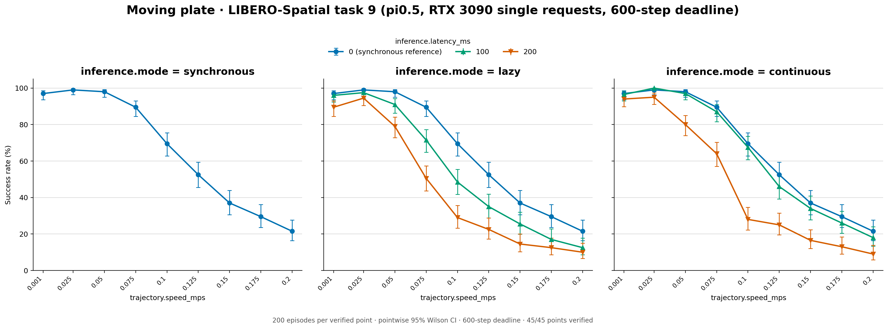
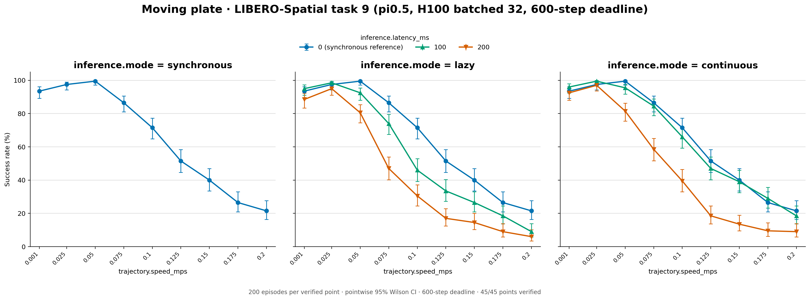
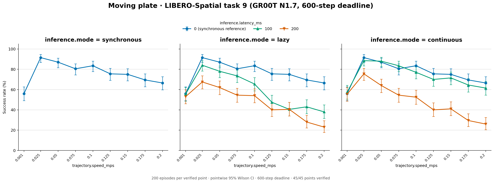
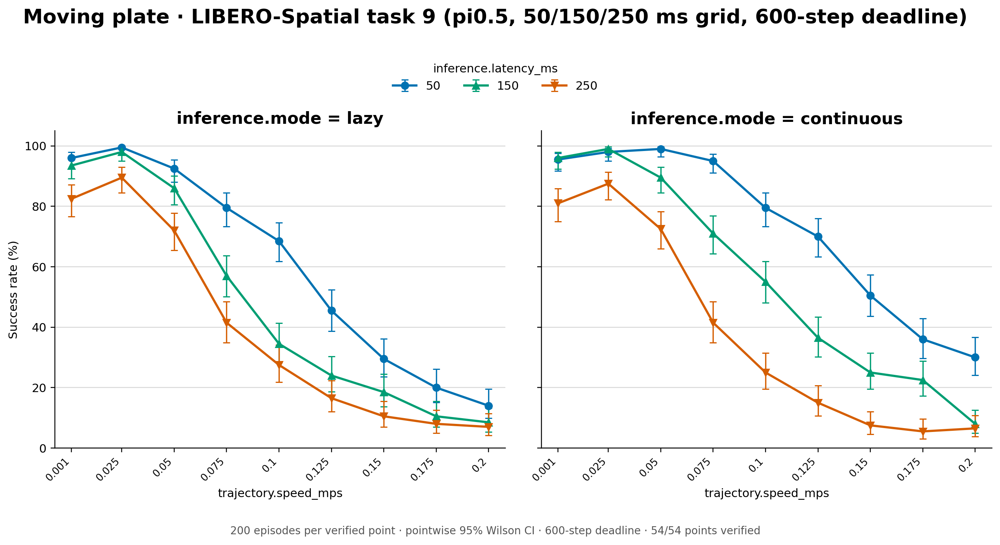
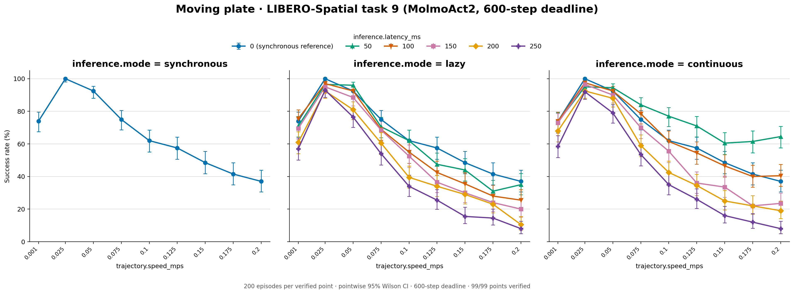
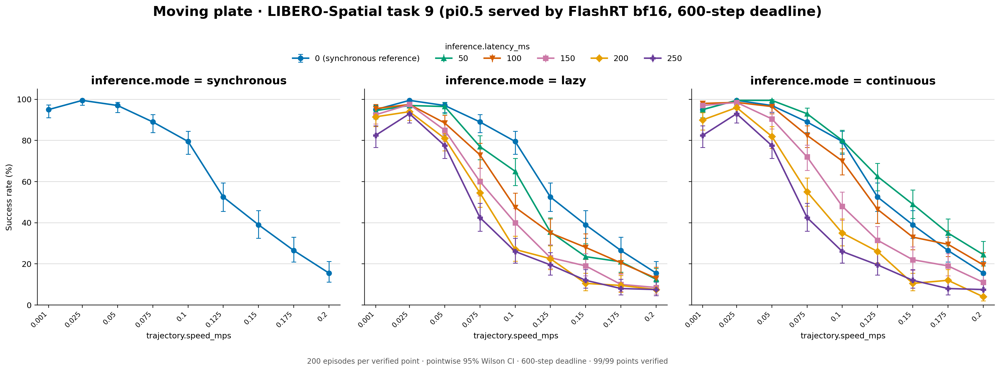
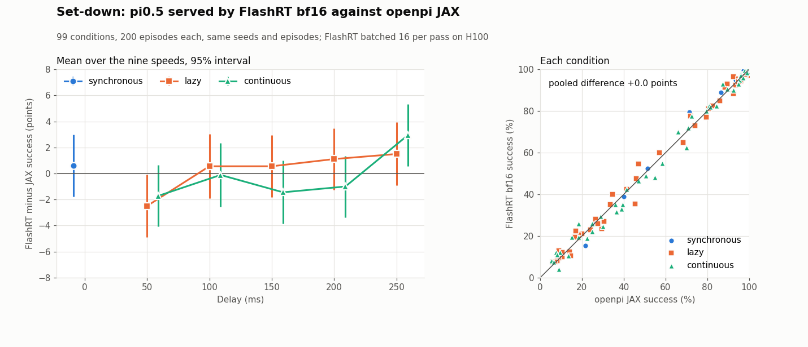
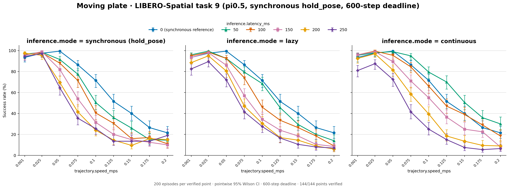
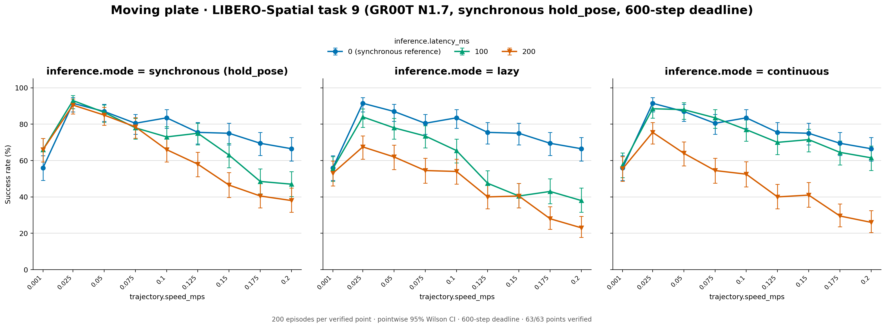
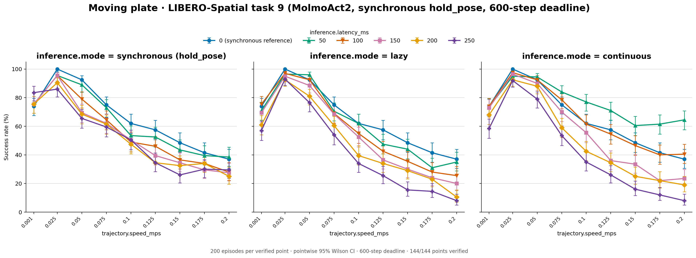

# Task 9 moving plate

LIBERO-Spatial Task 9 (pick the bowl on the wooden cabinet, place it on the
plate) with the plate moving on its ellipse; the bowl and cabinet stay put. Specs: `configs/studies/libero_spatial_task9_20261001/`.

Synchronous points with a nonzero delay are published only in the
`*-sync-hold-pose` folders (last section): their first runs let the arm keep
moving during inference waits, and the reruns hold it still, as synchronous
execution is defined. The other folders keep every other point as evaluated,
and the counts below leave out the synchronous points they no longer hold.

| Folder | Policy and serving | Run |
| --- | --- | --- |
| `pi05-xtra3090-single/` | pi0.5, one request per pass | RTX 3090 server, October 1, 2026 (`88a9d8d3`, `9fbbb764`) |
| `pi05-h100-b32/` | pi0.5, batches of up to 32 | H100 GPU 0, October 3, 2026 (`9bba628`) |
| `gr00t/` | GR00T N1.7 (`libero_spatial`), batches of up to 32 | H100 server, October 2, 2026 (`aa7be073`) |

Each folder holds the three-panel figure `success_rates.png` (synchronous,
lazy, continuous; synchronous 0 ms is drawn on the lazy panel as reference)
and `plot_data.csv`. All runs share the protocol: 200 episodes per point over
the 50 official states, seeds 7, 20 Hz, 10 warm-up steps, execution horizon
5, 600 acting steps; nine speeds (0.001, 0.025–0.2 m/s), synchronous at
0/100/200 ms, lazy and continuous at 100/200 ms. pi0.5 uses chunks of 10,
GR00T chunks of 16. 63 points per folder, all verified; 45 are published here.

| Folder | Synchronous 0 ms of 1,800 | Lazy of 3,600 | Continuous of 3,600 | Total of 9,000 |
| --- | --- | --- | --- | --- |
| `pi05-xtra3090-single` | 1,187 | 1,793 | 1,993 | 4,973 (55.3%) |
| `pi05-h100-b32` | 1,176 | 1,763 | 1,989 | 4,928 (54.8%) |
| `gr00t` | 1,370 | 1,896 | 2,201 | 5,467 (60.7%) |

Synchronous 0 ms by speed (0.001, 0.025, …, 0.2 m/s):

| Folder | Successes of 200 |
| --- | --- |
| `pi05-xtra3090-single` | 194 198 196 179 139 105 74 59 43 |
| `pi05-h100-b32` | 187 195 199 173 143 103 80 53 43 |
| `gr00t` | 112 183 174 161 167 151 150 139 133 |







## pi0.5 rerun on H100 with batched serving

The H100 rerun checks the RTX 3090 server result that lazy inference recovers little
of what latency costs. Settings are the original ones except serving: one
OpenPI server per H100 runs up to 32 requests per pass (no padding, no wait)
for 64 render-gated workers. Plate and cabinet together took 7.1 h end to end
including videos, with no episode errors.

The original result reproduces. Over the 126 plate and cabinet points as
first evaluated (including the synchronous points the reruns replace), total
successes are 13,760 (RTX 3090 server) vs 13,678 (H100); 2 points differ at
p < 0.05 (about 6 expected by chance) and none at p < 0.01. Continuous at
100 ms still comes closest to synchronous at 0 ms.

| Plate @ 0.075 m/s | sync 0 | lazy 100 | lazy 200 | cont 100 | cont 200 |
| --- | --- | --- | --- | --- | --- |
| RTX 3090 server, single requests | 179 | 143 | 101 | 174 | 128 |
| H100, batched | 173 | 148 | 94 | 169 | 117 |

Each request keeps the diffusion noise derived from its identity, so
batching changes floating-point evaluation only. On 48 real Task 9 requests
on an H100, a batch of one is bit-identical to single-request serving;
batched actions differ by mean 0.0006 (p99 0.003) against 0.016 for a policy
seed change, with actions averaging 0.39 in magnitude; a request's result
does not depend on its batch-mates. Paired against the RTX 3090 server run on 600
episodes, success moved +3.2 pp [-2.3, +8.6] (McNemar p = 0.28) with 46% of
outcomes flipping, the rate two single-request runs already show.

pi0.5 is GPU-compute-bound on an H100: a 32-request pass spends 362 of 372 ms
in the model (about 11 ms per request). One batched server reached 47-61
requests/s per GPU with rendering on the same GPU, against 16.6 single-request
and 85 offline. Two servers per GPU gave no more; two batches in flight on one
server matched sequential batches bit for bit but added 4% offline. The
measurement tools, sweep configs, and that two-in-flight option are on the
`libero-batching-h100` branch.

## Archive

## Reproduce

```bash
PYTHONPATH=src .venv/bin/python scripts/studies/plot_task9_20261001.py pi05 STUDY_ROOT OUT --tasks plate --flat
PYTHONPATH=src .venv/bin/python scripts/studies/plot_task9_20261001.py pi05 STUDY_ROOT OUT --tasks plate --flat --suffix b32_20261003
PYTHONPATH=src .venv/bin/python scripts/studies/plot_task9_20261001.py gr00t STUDY_ROOT OUT --tasks plate --flat
```

## pi0.5 latency grid

`pi05-latency-grid/`: pi0.5 at the delays between the 0/100/200 ms points,
figure `success_rates.png` and `plot_data.csv`. Synchronous, lazy, and
continuous at 50/150/250 ms; 0.001 and 0.025–0.2 m/s by 0.025; same protocol as above (200 episodes
per point over the 50 official states, seeds 7, 20 Hz, 10 warm-up steps,
chunks of 10, execution horizon 5, 600 acting steps). One batched pi0.5
server per GPU (up to 32 requests) on H100 GPUs 6 and 7, October 14–15,
2026 (branch `libero-latency-grid`, merged in #5). Specs:
`configs/studies/libero_latency_grid_20261014/`. All 81 points verified; the
54 lazy and continuous points are published here.

| Folder | Lazy of 5,400 | Continuous of 5,400 | Total of 10,800 |
| --- | --- | --- | --- |
| `pi05-latency-grid` | 2,661 | 2,996 | 5,657 (52.4%) |



## MolmoAct2

`molmoact2/`: MolmoAct2 (`allenai/MolmoAct2-LIBERO`, revision `0d24a925`,
bf16, chunks of 10, execution horizon 5), figure `success_rates.png` and
`plot_data.csv`. 200 episodes per point over the 50 official states, seeds 7,
20 Hz, 10 warm-up steps, 600 acting steps; nine speeds (0.001, 0.025, 0.05, 0.075, 0.1, 0.125, 0.15, 0.175, 0.2 m/s);
synchronous, lazy, and continuous at 50/100/150/200/250 ms plus synchronous
at 0 ms. Serving batches up to 32 requests (padded to 8/16/24/32 rows) on
three H100 GPUs with all rendering on a fourth, October 15–17, 2026
(commit `c880056e`, branch `molmoact2`). Specs:
`configs/studies/molmoact2_libero_20261015/`. All 144 points verified; 99 are
published here.

| Folder | Synchronous 0 ms of 1,800 | Lazy of 9,000 | Continuous of 9,000 | Total of 19,800 |
| --- | --- | --- | --- | --- |
| `molmoact2` | 1,176 | 4,735 | 5,195 | 11,106 (56.1%) |

Synchronous 0 ms by speed: 148 200 185 150 124 115 97 83 74 (successes of 200).



## pi0.5 served by FlashRT bf16

`pi05-flashrt-bf16/`: the same pi0.5 checkpoint (`pi05_libero`, converted to
PyTorch) served by FlashRT bf16 instead of openpi's JAX model, on every speed
and delay of the openpi grid: nine speeds (0.001, 0.025–0.2 m/s), synchronous
at 0/50/100/150/200/250 ms, lazy and continuous at 50–250 ms; same protocol
as above (200 episodes per point over the 50 official states, seeds 7, 20 Hz,
10 warm-up steps, chunks of 10, execution horizon 5, 600 acting steps). FlashRT runs every pass padded to 16 requests, so a request's actions do not
depend on its batch-mates; on the H100 its attention runs through pip
flash_attn (`FVK_RTX_FA2=0`). H100 GPUs 0–3, October 18, 2026 (evaluation
code `616cae5a`, specs `417bbedb`, branch `flashrt-batching`). Specs:
`configs/studies/flashrt_setdown_grid_20261018/`. All 144 points verified;
the 0.001 m/s continuous 150 ms point was rerun after five episodes lost their
server connection at step 0, and only the rerun is published. The FlashRT
synchronous points at nonzero delay were not rerun with the arm held, so 99
points are published here.

| Folder | Synchronous 0 ms of 1,800 | Lazy of 9,000 | Continuous of 9,000 | Total of 19,800 |
| --- | --- | --- | --- | --- |
| `pi05-flashrt-bf16` | 1,187 | 4,446 | 4,961 | 10,594 (53.5%) |

Synchronous 0 ms by speed: 190 199 194 178 159 105 78 53 31 (successes of 200).

Against openpi JAX pi0.5 at the same 99 conditions (`pi05-h100-b32` for
0/100/200 ms, `pi05-latency-grid` for 50/150/250 ms), FlashRT succeeds in
10,594 episodes against 10,585, +0.05 points. Every mode and delay is within
3 points averaged over the nine speeds; lazy 50 ms (−2.5) and continuous
250 ms (+2.9) fall just outside their 95% intervals. Single points differ by
3.3 points (standard deviation) and at most 10, against about ±9 points of
sampling noise per point at 200 episodes. `vs_jax.csv` lists both counts per condition.





```bash
PYTHONPATH=src .venv/bin/python scripts/studies/plot_flashrt_setdown_grid_20261018.py STUDY_ROOT results/libero
```

## Paper grids: synchronous reruns with the arm holding still

`pi05-sync-hold-pose/`, `gr00t-sync-hold-pose/`, `molmoact2-sync-hold-pose/`:
each model's full grid on 0.001 and 0.025–0.2 m/s, the one the paper reports.
Every synchronous point with a nonzero delay comes from the
`sync_hold_pose_20261026` reruns (`configs/studies/sync_hold_pose_20261026/`),
which hold the pose where each wait began. The first runs of those points
stepped every wait tick with a zero action, and under robosuite's delta OSC a
zero action keeps the previous orientation goal, so the arm kept turning while
it waited. The reruns use the same checkpoints, chunks, execution horizon and
200 episodes per point as the runs they replace; H100s, October 26–27, 2026,
commit `cf31e659`, batched serving (up to 32 requests per pass), all points
verified.

The synchronous 0 ms points never wait (a 0 ms request is available on the
step it is sent) and come from the original runs, as do the lazy and
continuous points; lazy 0 ms runs are left out because they schedule like
synchronous 0 ms. `plot_data.csv` gives each row's `idle_control` (`hold_pose`
for the reruns) and its `source` folder or study. The first synchronous runs were also batched (up to 32 requests per pass).

| Folder | Lazy, continuous and 0 ms from | Rerun delays (ms) | Synchronous, held | Total |
| --- | --- | --- | --- | --- |
| `pi05-sync-hold-pose` | `pi05-h100-b32` + `pi05-latency-grid` | 50/100/150/200/250 | 4,307 of 9,000 (47.9%) | 14,892 of 28,800 (51.7%) |
| `gr00t-sync-hold-pose` | `gr00t` | 100/200 | 2,398 of 3,600 (66.6%) | 7,865 of 12,600 (62.4%) |
| `molmoact2-sync-hold-pose` | `molmoact2` | 50/100/150/200/250 | 4,974 of 9,000 (55.3%) | 16,080 of 28,800 (55.8%) |







Redraw a figure from its table with
`scripts/studies/plot_results_table.py FOLDER --title TITLE --deadline 600`.

## Execution-horizon validation

`pi05-horizon-validation/` holds pi0.5's asynchronous (lazy) runs at 50 ms with
execution horizons H = 2, 3 and 4 at the nine grid speeds, 200 episodes each
(H100 server, October 25, 2026, benchmark `829ae7c8`; spec
`configs/studies/horizon_validation_20261025/pi05_plate_lazy50.yaml`). The
paper uses them to test the speed-scaling model at horizons other than H = 5,
and H = 4 is System C's rate-capped continuous execution (Section 5).

| H | Success |
| --- | --- |
| 2 | 1,255/1,800 (69.7%) |
| 3 | 1,175/1,800 (65.3%) |
| 4 | 1,117/1,800 (62.1%) |
