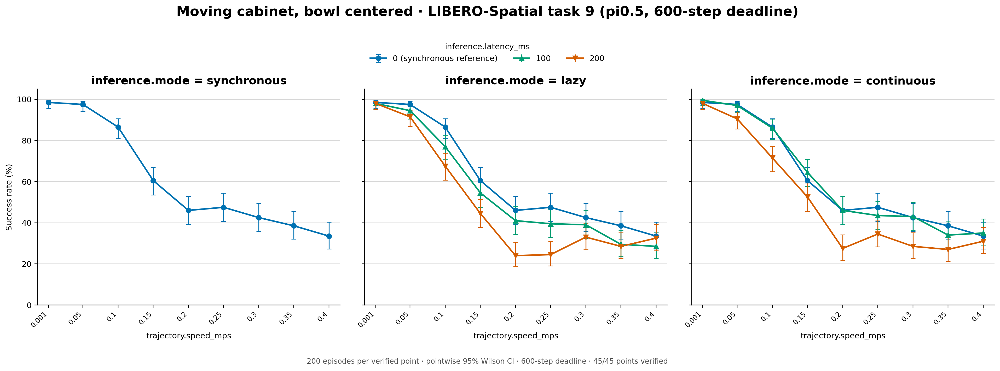
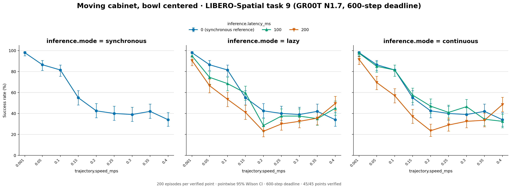
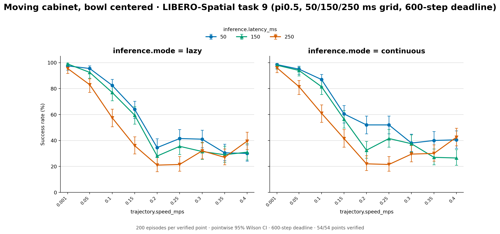
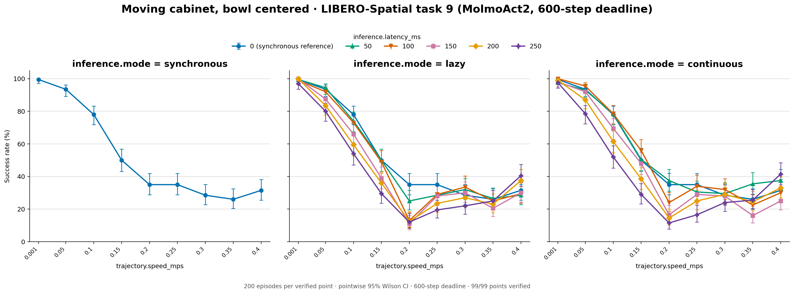
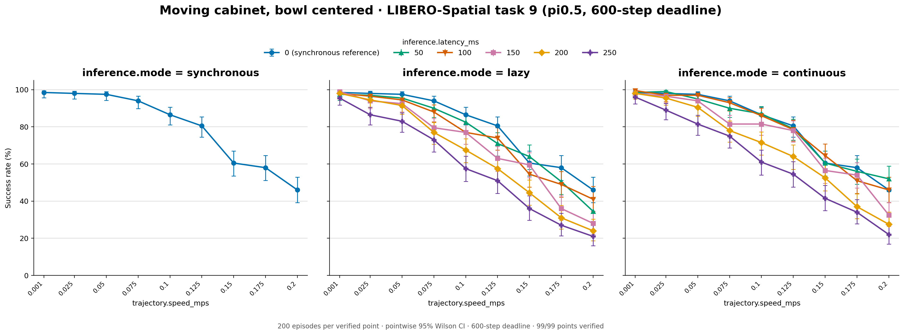
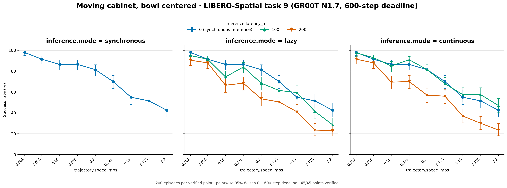
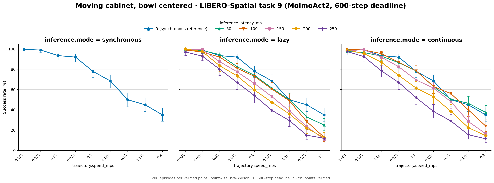
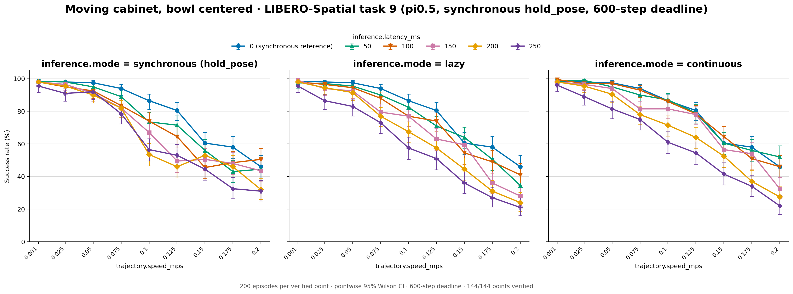
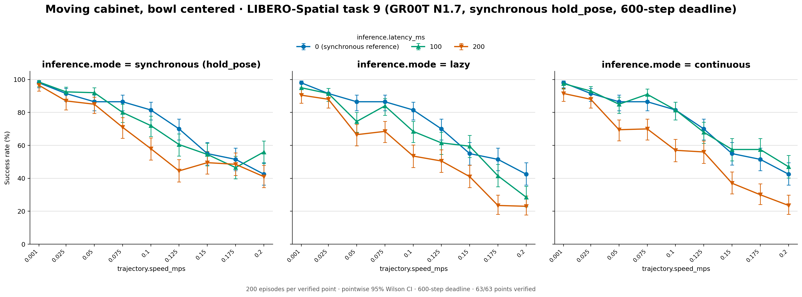
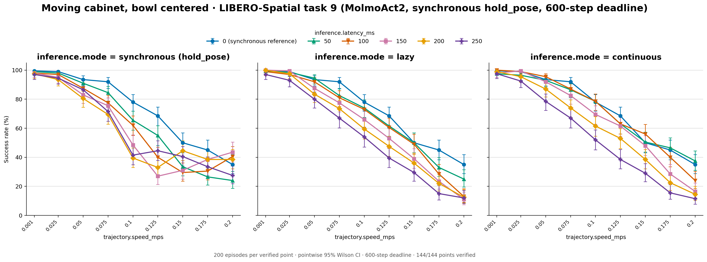

# Task 9 moving cabinet, bowl centered

LIBERO-Spatial Task 9 (pick the bowl on the wooden cabinet, place it on the
plate) with the cabinet moving on its ellipse and the bowl now pinned at the
center of the cabinet top in all 50 states (commit `a21005b4`). Before, the
bowl kept its official xy, 0.2–5.3 cm from the top center, so the carried
bowl path differed between episodes.

Synchronous points with a nonzero delay are published only in the
`*-sync-hold-pose` folders (last section): their first runs let the arm keep
moving during inference waits, and the reruns hold it still, as synchronous
execution is defined. The other folders keep every other point as evaluated,
and the counts below leave out the synchronous points they no longer hold.

- `pi05/`: pi0.5, figure `success_rates.png` and `plot_data.csv`
- `gr00t/`: GR00T N1.7 (`libero_spatial`), same files

Both models use the settings of the earlier H100 batched runs, except for the
bowl pin: 200 episodes per point over the 50 official states, seeds 7, 20 Hz,
10 warm-up steps, 600 acting steps; nine speeds (0.001, 0.05–0.4 m/s),
synchronous at 0/100/200 ms, lazy and continuous at 100/200 ms. Serving
batches up to 32 requests (pi0.5: one OpenPI server, 48 workers per GPU; GR00T: two servers, 32 workers each). Specs:
`configs/studies/libero_spatial_task9_bowl_centered_20261010/`. Run on
H100 GPUs 0–1 on October 10, 2026 (commit `0851f1a7`): 126 points, all
verified; 90 are published here (45 per folder).





## Reproduce

```bash
for m in pi05 gr00t; do
  suffix=20261010; [ $m = pi05 ] && suffix=b32_20261010
  PYTHONPATH=src .venv/bin/python scripts/studies/plot_task9_20261001.py $m \
    studies/libero_spatial_task9_bowl_centered_20261010 \
    results/libero/20261010_task9-moving-cabinet-bowl-centered/$m \
    --tasks cabinet --flat --suffix $suffix \
    --name-format '{policy}_task9_{task}_bowl_centered_{mode}_{suffix}' \
    --variant 'bowl centered'
done
```

## pi0.5 latency grid

`pi05-latency-grid/`: pi0.5 at the delays between the 0/100/200 ms points,
figure `success_rates.png` and `plot_data.csv`. Synchronous, lazy, and
continuous at 50/150/250 ms; 0.001 and 0.05–0.4 m/s by 0.05; same protocol as above (200 episodes
per point over the 50 official states, seeds 7, 20 Hz, 10 warm-up steps,
chunks of 10, execution horizon 5, 600 acting steps). One batched pi0.5
server per GPU (up to 32 requests) on H100 GPUs 6 and 7, October 14–15,
2026 (branch `libero-latency-grid`, merged in #5). Specs:
`configs/studies/libero_latency_grid_20261014/`. All 81 points verified; the
54 lazy and continuous points are published here.

| Folder | Lazy of 5,400 | Continuous of 5,400 | Total of 10,800 |
| --- | --- | --- | --- |
| `pi05-latency-grid` | 2,826 | 2,968 | 5,794 (53.6%) |



## MolmoAct2

`molmoact2/`: MolmoAct2 (`allenai/MolmoAct2-LIBERO`, revision `0d24a925`,
bf16, chunks of 10, execution horizon 5), figure `success_rates.png` and
`plot_data.csv`. 200 episodes per point over the 50 official states, seeds 7,
20 Hz, 10 warm-up steps, 600 acting steps; nine speeds (0.001, 0.05, 0.1, 0.15, 0.2, 0.25, 0.3, 0.35, 0.4 m/s);
synchronous, lazy, and continuous at 50/100/150/200/250 ms plus synchronous
at 0 ms. Serving batches up to 32 requests (padded to 8/16/24/32 rows) on
three H100 GPUs with all rendering on a fourth, October 15–17, 2026
(commit `c880056e`, branch `molmoact2`). Specs:
`configs/studies/molmoact2_libero_20261015/`. All 144 points verified; 99 are
published here.

| Folder | Synchronous 0 ms of 1,800 | Lazy of 9,000 | Continuous of 9,000 | Total of 19,800 |
| --- | --- | --- | --- | --- |
| `molmoact2` | 954 | 4,191 | 4,345 | 9,490 (47.9%) |

Synchronous 0 ms by speed: 199 187 156 100 70 70 57 52 63 (successes of 200).



## Speed fill: the 0–0.2 m/s grid

The other three paper tasks use 0.001 and 0.025–0.2 m/s by 0.025. Above
about 0.2 m/s this task's success levels off because the looping bowl comes
back to a waiting hand, so those speeds measure interception. Capped at 0.2
m/s the bowl had only five speeds. The October 21 runs add 0.025, 0.075,
0.125 and 0.175 m/s at every delay the three models already have, giving the
same nine-speed grid.

- `pi05-speed-fill/`, `gr00t-speed-fill/`, `molmoact2-speed-fill/`: figure
  `success_rates.png` and `plot_data.csv` over the full grid. The four new
  speeds come from commit `f66fd44c`; the other five rows are those of
  `pi05` + `pi05-latency-grid`, `gr00t`, and `molmoact2` above.

Same protocol and serving as the runs they fill (200 episodes per point over
the 50 official states, seeds 7, 20 Hz, 10 warm-up steps, 600 acting steps,
batching up to 32). Specs: `configs/studies/bowl_speed_fill_20261021/`. Run
on H100 GPUs 0–3 on October 21, 2026: 156 new points, all verified. The
folders publish the full grid without its synchronous points at nonzero delay.

| Folder | Synchronous 0 ms | Lazy | Continuous | Published grid |
| --- | --- | --- | --- | --- |
| `pi05-speed-fill` | 1,439 of 1,800 | 6,199 of 9,000 | 6,542 of 9,000 | 14,180 of 19,800 (71.6%) |
| `gr00t-speed-fill` | 1,326 of 1,800 | 2,219 of 3,600 | 2,401 of 3,600 | 5,946 of 9,000 (66.1%) |
| `molmoact2-speed-fill` | 1,321 of 1,800 | 5,575 of 9,000 | 5,832 of 9,000 | 12,728 of 19,800 (64.3%) |

Synchronous 0 ms by speed (0.001, 0.025, …, 0.2 m/s; successes of 200):

| Policy | |
| --- | --- |
| pi0.5 | 197 196 195 188 173 161 121 116 92 |
| GR00T | 196 183 173 173 163 140 110 103 85 |
| MolmoAct2 | 199 198 187 184 156 137 100 90 70 |







```bash
PYTHONPATH=src .venv/bin/python scripts/studies/plot_bowl_speed_fill_20261021.py \
  studies results/libero
```

## Paper grids: synchronous reruns with the arm holding still

`pi05-sync-hold-pose/`, `gr00t-sync-hold-pose/`, `molmoact2-sync-hold-pose/`:
each model's full grid on 0.001 and 0.025–0.2 m/s, the one the paper reports.
Every synchronous point with a nonzero delay comes from the
`sync_hold_pose_20261026` reruns (`configs/studies/sync_hold_pose_20261026/`),
which hold the pose where each wait began. The first runs of those points
stepped every wait tick with a zero action, and under robosuite's delta OSC a
zero action keeps the previous orientation goal, so the arm kept turning while
it waited. The reruns use the same checkpoints, chunks, execution horizon and
200 episodes per point as the runs they replace; H100s, October 26–27, 2026,
commit `cf31e659`, batched serving (up to 32 requests per pass), all points
verified.

The synchronous 0 ms points never wait (a 0 ms request is available on the
step it is sent) and come from the original runs, as do the lazy and
continuous points; lazy 0 ms runs are left out because they schedule like
synchronous 0 ms. `plot_data.csv` gives each row's `idle_control` (`hold_pose`
for the reruns) and its `source` folder or study. The first synchronous runs were also batched (up to 32 requests per pass). The October 10 grid's speeds above 0.2 m/s have no rerun and no published synchronous points at nonzero delay.

| Folder | Lazy, continuous and 0 ms from | Rerun delays (ms) | Synchronous, held | Total |
| --- | --- | --- | --- | --- |
| `pi05-sync-hold-pose` | `pi05-speed-fill` | 50/100/150/200/250 | 6,235 of 9,000 (69.3%) | 20,415 of 28,800 (70.9%) |
| `gr00t-sync-hold-pose` | `gr00t-speed-fill` | 100/200 | 2,467 of 3,600 (68.5%) | 8,413 of 12,600 (66.8%) |
| `molmoact2-sync-hold-pose` | `molmoact2-speed-fill` | 50/100/150/200/250 | 5,503 of 9,000 (61.1%) | 18,231 of 28,800 (63.3%) |







Redraw a figure from its table with
`scripts/studies/plot_results_table.py FOLDER --title TITLE --deadline 600`.
