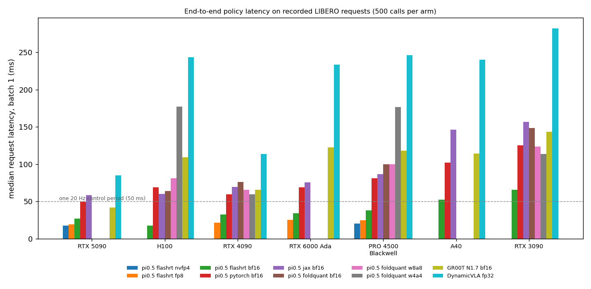

# Batch-1 policy latency across GPUs and quantizations

End-to-end request latency of pi0.5 (openpi JAX, openpi PyTorch, FlashRT,
FoldQuant), GR00T N1.7 and DynamicVLA, one request at a time, on recorded
LIBERO requests (96 plate requests for pi0.5 and GR00T, recorded FCAN04
requests for DynamicVLA). Each arm: 20 warm-up calls, then 500 timed calls,
alone on its GPU (`exclusive` in every record). Measured with
`scripts/latency/policy_latency.py` on requests rebuilt by
`scripts/latency/policy_frames.py`; tables from
`scripts/latency/latency_table.py --csv`. The released tool keeps the
pi0.5 openpi and FlashRT bf16 paths; the FlashRT FP8/NVFP4, FoldQuant,
GR00T and DynamicVLA rows came from the study's fuller version of it, and
the figure from the study's plotting script, neither of which is released.

- `latency.csv`: one row per GPU and arm. p50/p95/p99 end to end, model-only
  p50, steps stale at the control rate (LIBERO 20 Hz, DynamicVLA 25 Hz),
  host load average at start, mean absolute arm-action difference from the
  recorded JAX chunks (`arm_mean_abs`, pi0.5 rerun floor about 0.006), and
  the source record.
- `h100_busy_host_passes.csv`: the two earlier H100 passes, taken while
  other jobs loaded the shared host (load 35 to 125). They show how far
  launch-bound arms move with host load; `latency.csv` holds the quietest
  H100 pass.
- `latency_p50.png`: median latency of every in-process arm per GPU.

## Hosts

| GPU | Host | CPU (lscpu) |
| --- | --- | --- |
| RTX 3090 | RTX 3090 server | Xeon Gold 6226R |
| H100 80GB HBM3 | shared server | Xeon Platinum 8481C |
| RTX 4090 | cloud | Ryzen 9 7950X |
| RTX 5090 | cloud | Ryzen 9 9950X |
| RTX 6000 Ada | cloud | Xeon Gold 6348 |
| A40 | cloud | Xeon Gold 6342 |
| RTX PRO 4500 Blackwell (200 W cap) | cloud | EPYC 7443, about 10 vCPU quota |

The pod CPU models were read with lscpu during the runs; records from
commit 6a510dd6 on store them.

## Reading the numbers

- FlashRT replays CUDA graphs and is flat across host load. GR00T,
  DynamicVLA, openpi PyTorch and FoldQuant launch many small kernels from
  Python, so their latency tracks the host CPU: on the Xeon-hosted 6000 Ada
  and A40 they run about twice as slow as on the Ryzen-hosted 4090 and 5090,
  model time included. Read those rows as GPU plus host.
- FP8 needs sm_89 or newer; NVFP4 needs sm_120. The
  Blackwell FoldQuant, GR00T and DynamicVLA environments sat on the volume,
  so those three rows may read slightly high.
- The Blackwell GPU is capped at 200 W and drops from about 2.8 to 2.4 to
  2.6 GHz under sustained calls; its rows are steady state at that cap.

