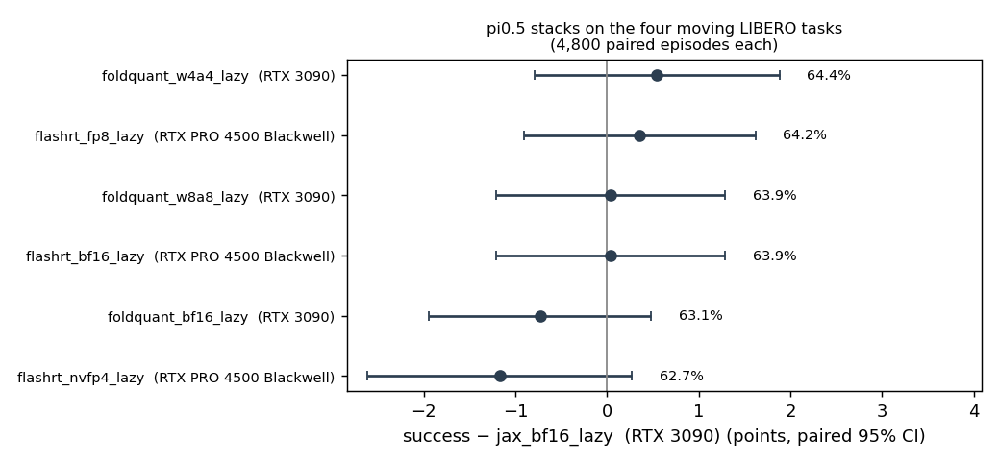

# pi0.5 stack and quantization success, lazy asynchronous at 100 and 200 ms

Do quantized pi0.5 stacks keep their success when the robot keeps executing
while the next chunk is computed, as on a real deployment? Each stack runs
the same episodes as in [`../success-sync/`](../success-sync/README.md) in
lazy asynchronous mode with an injected inference latency of 100 ms and
200 ms. The latency is identical for every stack, so a difference measures
output quality under real-time execution, not compute speed.

- Same four moving tasks, speeds, seeds and 200 episodes per point as the
  synchronous runs; 6 points per task (3 speeds × 2 latencies), so 4,800
  paired episodes per stack. 20 Hz control, chunk 10, execute 5.
- Reference: openpi JAX bf16 on an RTX 3090, lazy. FlashRT stacks ran on an
  RTX PRO 4500 Blackwell (the only GPU with NVFP4) and are also paired
  against FlashRT bf16 on that GPU.

| Stack | GPU | 100 ms | 200 ms | Pooled | Δ vs JAX bf16 lazy [95% CI] | Discordant |
| --- | --- | ---: | ---: | ---: | --- | ---: |
| openpi JAX bf16 | RTX 3090 | 66.2% | 61.5% | 63.8% | — | — |
| FoldQuant bf16 | RTX 3090 | 66.6% | 59.6% | 63.1% | −0.7 [−1.9, +0.5] | 18.4% |
| FoldQuant W8A8 | RTX 3090 | 66.5% | 61.3% | 63.9% | +0.0 [−1.2, +1.3] | 19.5% |
| FoldQuant W4A4 | RTX 3090 | 66.7% | 62.1% | 64.4% | +0.5 [−0.8, +1.9] | 22.2% |
| FlashRT bf16 | PRO 4500 Blackwell | 67.0% | 60.8% | 63.9% | +0.0 [−1.2, +1.3] | 19.5% |
| FlashRT FP8 | PRO 4500 Blackwell | 66.6% | 61.8% | 64.2% | +0.4 [−0.9, +1.6] | 20.1% |
| FlashRT NVFP4 | PRO 4500 Blackwell | 64.8% | 60.6% | 62.7% | −1.2 [−2.6, +0.3] | 25.9% |

Against FlashRT bf16 on the same GPU: FP8 +0.3 [−1.0, +1.6], NVFP4 −1.2
[−2.6, +0.2].

## Findings

- FP8, W8A8 and W4A4 keep bf16's success under real-time execution at
  both latencies, as they do synchronously.
- NVFP4 again loses precision rather than robustness. Against FlashRT bf16
  it drops on the near-static and slow points (basket 0.001 m/s −12 and
  −10 at 100 and 200 ms, drawer 0.001 m/s −10 and −7.5, drawer 0.025 m/s
  −8 and −7) and is level or higher on the moving basket (+8 to +11.5). Pooled, the static losses and moving gains largely cancel, so its lazy
  deficit (−1.2) is smaller than its synchronous one (−5.5) without being a
  recovery.
- 200 ms costs about 5 points against 100 ms for every stack alike.

## Reference noise and extra references (added after the main runs)

A second JAX bf16 lazy session, with its own XLA compilation, plus openpi
PyTorch bf16 and FlashRT bf16 on the same RTX 3090, against JAX bf16 lazy:

| Stack | Pooled | Δ [95% CI] | Discordant |
| --- | ---: | --- | ---: |
| JAX bf16, repeat | 64.1% | +0.3 [−0.9, +1.5] | 18.1% |
| openpi PyTorch bf16 | 64.2% | +0.3 [−0.9, +1.6] | 18.9% |
| FlashRT bf16 (RTX 3090) | 63.9% | +0.1 [−1.1, +1.3] | 19.1% |
| BitBLAS W8A8 | 61.8% | −2.0 [−3.4, −0.7] | 23.2% |

The bf16 references agree within 0.3 points. BitBLAS W8A8's −2.0
([`../success-bitblas/`](../success-bitblas/README.md)) lies outside that
spread. FlashRT NVFP4's pooled −1.2 is borderline (its interval reaches
+0.3), but its near-static losses of 7.5 to 12 points are well outside it. All RTX 3090 lazy
rows are in `rtx3090_all_vs_jax_bf16_lazy.csv` (outcomes sha256
`b8aff243dbe5863fee8bb857a078dd6be991ddbd66617e7ab20b9e3767a18958`).

## Files

- `vs_jax_bf16_lazy.csv`: every stack against JAX bf16 lazy, pooled (task
  empty) and per task, speed and latency.
- `blackwell_vs_flashrt_bf16_lazy.csv`: FP8 and NVFP4 against FlashRT bf16
  on the same GPU.
- `success_delta.png`: pooled differences with 95% intervals.

Per-episode outcomes (sha256): RTX 3090 server lazy
`ea1fb0582df68dbdd368b13f17db3e6fcbe4e7d98d90592891876ff59e3d6e01`,
cloud RTX PRO 4500 Blackwell lazy
`464afb154573e4d1c007dc1207c224be07f3754cbd0a48143c30d1d2ab326aaf`. Specs are
`configs/studies/pi05_stacks_20261014/*_lazy/`.
