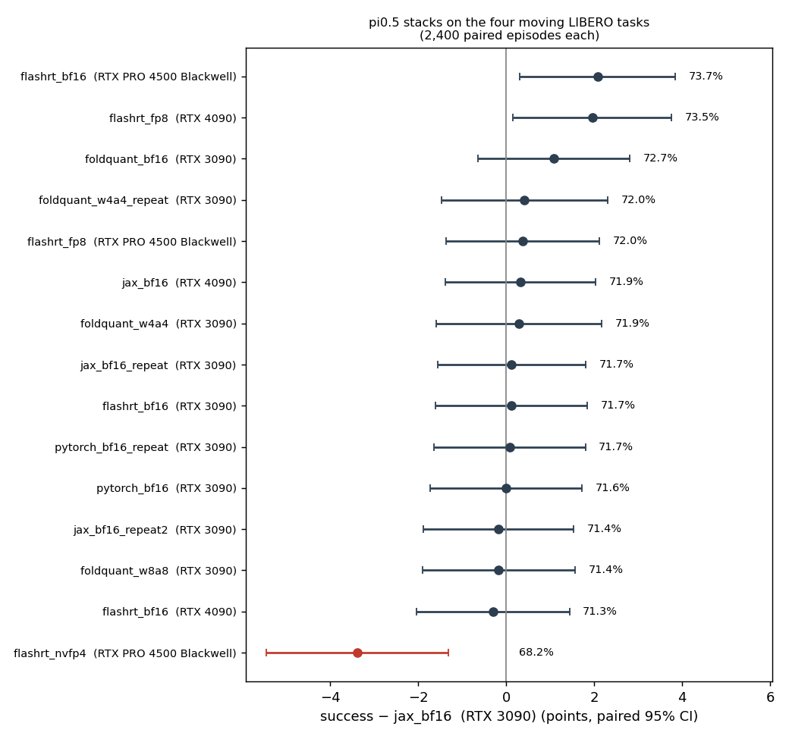

# pi0.5 stack and quantization success, synchronous 0 ms

Does a different inference stack or a quantized pi0.5 keep the production
model's output quality? Every stack serves the same `pi05_libero` weights
(converted to PyTorch for the non-JAX stacks, or quantized from them) on
the paper's four moving LIBERO tasks, with the simulator paused during
inference (synchronous, 0 ms). Compute speed therefore cannot change
success; only the actions can.

- Tasks and speeds (m/s): plate (Spatial task 9) 0.001 / 0.10 / 0.15;
  bowl-centered cabinet 0.001 / 0.15 / 0.25; basket (Object task 1)
  0.001 / 0.10 / 0.15; drawer (Goal task 0) 0.001 / 0.025 / 0.05.
- 200 episodes per point with identical initial states, target motion and
  request noise for every stack, so outcomes pair by episode: 2,400 paired
  episodes per stack. Single-request serving, 20 Hz control, chunk 10,
  execute 5.
- Reference: openpi JAX bf16 (the production path) on an RTX 3090.

| Stack | GPU | Success | Δ vs JAX bf16 [paired 95% CI] | Discordant | Model ms |
| --- | --- | ---: | --- | ---: | ---: |
| openpi JAX bf16, repeat 1 / 2 | RTX 3090 | 71.7 / 71.4% | +0.1 / −0.2 | 17.7 / 18.2% | 157 |
| openpi PyTorch bf16, run / repeat | RTX 3090 | 71.6 / 71.7% | +0.0 / +0.1 | 18.4 / 18.3% | 131 |
| FlashRT bf16 | RTX 3090 | 71.7% | +0.1 [−1.6, +1.8] | 18.5% | 66 |
| FoldQuant bf16 (TensorRT) | RTX 3090 | 72.7% | +1.1 [−0.6, +2.8] | 18.7% | 154 |
| FoldQuant W8A8 | RTX 3090 | 71.4% | −0.2 [−1.9, +1.6] | 18.8% | 128 |
| FoldQuant W4A4, run / repeat | RTX 3090 | 71.9 / 72.0% | +0.3 / +0.4 | 22.1 / 22.3% | 118 |
| openpi JAX bf16 | RTX 4090 | 71.9% | +0.3 [−1.4, +2.0] | 18.2% | 71 |
| FlashRT bf16 | RTX 4090 | 71.3% | −0.3 [−2.0, +1.4] | 18.8% | 34 |
| FlashRT FP8 | RTX 4090 | 73.5% | +2.0 [+0.2, +3.8] | 20.2% | 23 |
| FlashRT bf16 | RTX PRO 4500 Blackwell | 73.7% | +2.1 [+0.3, +3.9] | 19.6% | 38 |
| FlashRT FP8 | RTX PRO 4500 Blackwell | 72.0% | +0.4 [−1.4, +2.1] | 19.1% | 25 |
| **FlashRT NVFP4** | RTX PRO 4500 Blackwell | **68.2%** | **−3.4 [−5.4, −1.3]** | 26.9% | 21 |

Against FlashRT bf16 on the same GPU: Blackwell FP8 −1.7 [−3.4, +0.0],
NVFP4 −5.5 [−7.5, −3.4]; 4090 FP8 +2.3 [+0.5, +4.1].

## Findings

- Every bf16 stack and both 8-bit schemes hold the production success rate. Pooled differences fall within about ±2 points, the spread of the JAX
  reruns themselves.
- NVFP4 is the one real loss: −3.4 points against JAX and −5.5 against
  bf16 on its own GPU. Against that bf16 it drops even on near-static points
  (basket −9.5, drawer −12.5 at 0.001 m/s), so its errors cost grasp precision rather
  than timing. Its actions move about six times further from JAX's
  (arm mean abs 0.036 vs 0.006).
- FoldQuant W4A4 (INT4 with 8-bit residual layers) holds success in two
  runs. NVFP4 does not, so the 4-bit scheme matters more than the bit width.
- Closed-loop outcomes are chaotic in the actions. Any change of arithmetic
  flips about 18% of paired episodes, including two JAX sessions whose XLA
  autotuning differed, while pooled success stays put. The PyTorch and
  TensorRT stacks are nearly deterministic: their repeats flip 0.2% and
  0.5%. Read per-episode agreement against that 18% floor; W4A4 adds about
  4 points to it and NVFP4 about 8.
- The +2 point readings (Blackwell bf16, 4090 FP8) sit at the edge of this
  noise. There are fifteen comparisons, and two at that level are expected.

## Files

- `vs_jax_bf16.csv`: every stack against JAX bf16 on the RTX 3090, pooled
  (task empty) and per task and speed.
- `blackwell_vs_flashrt_bf16.csv`, `rtx4090_vs_flashrt_bf16.csv`: the same
  against FlashRT bf16 on the same GPU.
- `success_delta.png`: pooled differences with 95% intervals.

Built with `scripts/studies/pi05_stacks_compare.py --csv` from per-episode
outcome tables written by `scripts/studies/pi05_stacks_outcomes.py` (the
figure came from a plotting script that is not released):

| Host | Outcomes (sha256) |
| --- | --- |
| RTX 3090 server (40 studies) | `cd1f959c2f5b35a3af4c1f00d1dbe78161335cfe5acfee5c87ca180ee68d30c3` |
| cloud RTX 4090 (12) | `1a4d757430d383c4ba06525142f12be643bf1216f4e155fe92b7627b1c744843` |
| cloud RTX PRO 4500 Blackwell (12) | `2cb185040ae7da11ab6463fdd22430e6e284adca8a77e6a9aac82f9b2d1fa5db` |

The bf16 specs (openpi JAX, openpi PyTorch, FlashRT) are in
`configs/studies/pi05_stacks_20261014/`. The quantized rows are kept for
reference; the paper uses bf16 only, and this release omits their specs and
engines.
